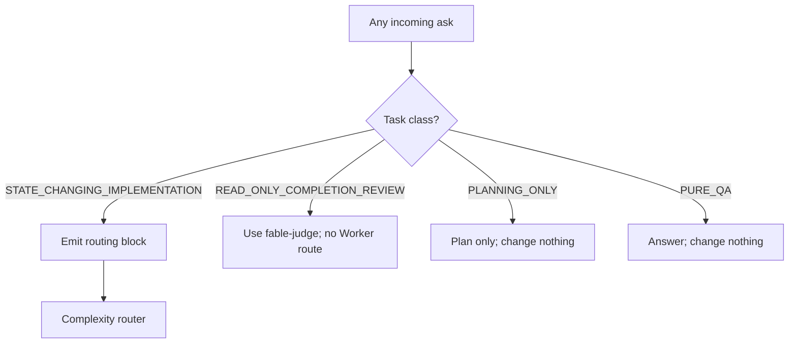
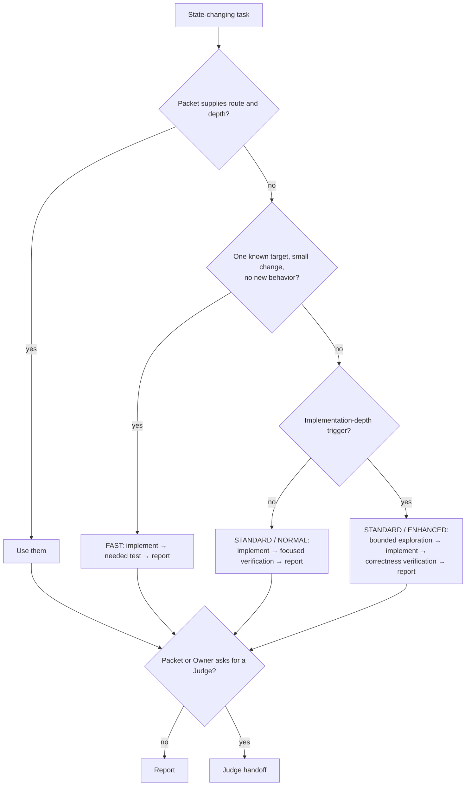
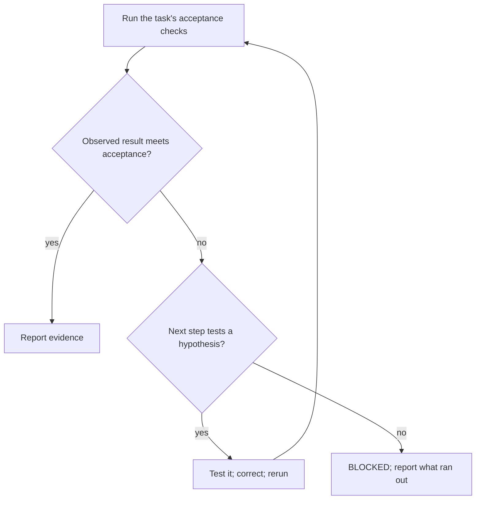
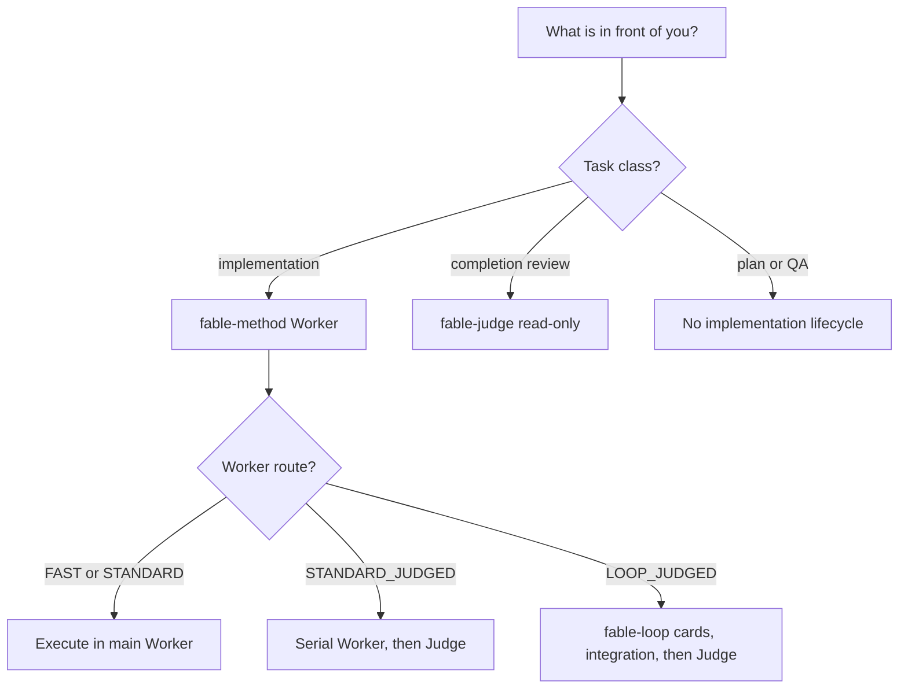

# The workflow, drawn

## Contents

1. [Master router](#1-master-router)
2. [Complexity router](#2-complexity-router)
3. [Verification](#3-verification)
4. [Family router](#4-family-router)

These charts summarize `SKILL.md`; they add no rules.

## 1. Master router

If evidence disproves the initial task class, emit `TASK_CLASS_RECLASSIFIED`
with `FROM`, `TO`, `EVIDENCE`, and `IMPACT_ON_ROUTE` before switching branches.

## 2. Complexity router

## 3. Verification

## 4. Family router

